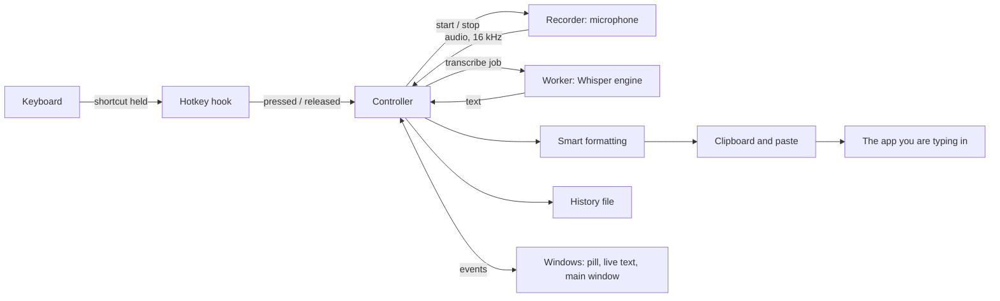

# How local-stt is built

A plain-language tour of the app for anyone new to the code. You need to know a little Rust and a
little HTML; everything else is explained here. For the rules every change follows, see
[AGENTS.md](../AGENTS.md) and the [design guide](design-guide.md).

## The app in one paragraph

local-stt is a desktop app that turns your voice into text. You hold a shortcut, speak, and let go.
The app records the microphone, runs **Whisper** (a speech recognition model) on your own computer,
tidies the text, and pastes it into whatever app you were typing in. Nothing is sent to a server.

It is written in **Rust** with **Tauri 2** (a toolkit for desktop apps whose screens are web pages).
The speech model runs through **whisper.cpp** (a C++ library), compiled into the same program.

## The big picture

Read it left to right: **a key press becomes a recording, the recording becomes text, the text
becomes a paste.**

## What happens when you dictate

1. You hold **Fn + Shift** (Mac) or **Ctrl + Alt** (Windows). The **hotkey hook** sees every key
   press, keeps only the keys currently held, and tells the controller when your shortcut is down.
2. The **controller** asks the **recorder** to open the microphone and shows the **pill** (the small
   floating window) in its recording state.
3. While you speak, the recorder keeps the sound in memory and reports the volume, so the pill's
   bars move. About every 0.8 seconds the controller asks the worker for a quick **preview** of the
   last 18 seconds, which the live text window shows above the pill.
4. You let go. The controller stops the recorder and sends the whole recording to the **worker**.
   A recording stops by itself after 5 minutes.
5. The worker runs **Whisper** on the audio and returns the text. If you chose English output,
   Whisper translates into English at the same time.
6. **Smart formatting** (plain rules, no AI) removes "uh" and "um", fixes spacing and turns spoken
   lists ("point one ... point two") into a numbered list.
7. The text goes on the **clipboard** (marked private, so clipboard managers skip it), and the app
   sends **Cmd + V** or **Ctrl + V** to paste it.
8. The text is saved to **history** (if history is on) and the pill shows "Pasted", then hides.
9. The audio is dropped. It is never written to disk.

## The parts

| Part | Where | Its job, in one line |
|---|---|---|
| Command line | `src/main.rs` | Starts the app, or runs a command such as `doctor`, `install` or `diagnostics` |
| App setup | `src/app.rs` | Builds the windows and the tray icon, and starts the controller and the worker |
| State machine | `src/state.rs` | Decides what a key press means right now (start, stop, cancel, hands-free) |
| Hotkey hook | `src/hotkey/` | Listens to the keyboard; one file per operating system |
| Recorder | `src/recorder.rs`, `src/audio.rs` | Opens the microphone and turns its sound into 16 kHz mono samples |
| Engine | `src/engine.rs`, `shim.cpp`, `llm_shim.cpp` | Talks to whisper.cpp and llama.cpp; the small C++ shims stop C++ errors crashing Rust |
| Smart formatting | `src/format.rs` | Rules that tidy the text |
| Paste | `src/output/`, `src/clipboard.rs` | The paste key press and the private clipboard write |
| Pill placement | `src/overlay.rs`, `src/focus/` | Where the pill goes: the screen you are typing on, your saved spot |
| Models | `src/models.rs`, `src/download.rs`, `src/hwprobe/` | Which Whisper models fit this computer; downloads checked by SHA-256; deleting unused ones |
| Files | `src/config.rs`, `src/history.rs`, `src/paths.rs` | Settings and history on disk |
| Install and updates | `src/install.rs`, `src/update.rs`, `src/autostart.rs` | Install to Applications or the Start menu, updates, start at login |
| Troubleshooting | `src/diag.rs` | The event log and the diagnostic report |
| One copy only | `src/instance.rs` | A second launch shows the running app instead of starting another |
| Screens | `ui/` | Plain HTML, CSS and JavaScript for the pill, the live text and the main window |

## Meeting notes

Notes reuse the same engine for a whole call instead of one dictation:

1. **Two sources at once.** Your microphone is **Me**; what your computer plays (the call) is
   **Others**, captured with the sound card's loopback, so no bot joins the meeting.
   With Echo cancellation on, `src/notes/echo.rs` first takes the call's sound out of the
   microphone in 10 ms frames, using the call audio as the reference (WebRTC AEC3 via `sonora`).
2. **Cut at pauses.** Each source goes through the **segmenter** (`src/notes/segmenter.rs`), which
   ends a piece of speech after 0.6 seconds of quiet, or at 25 seconds, whichever comes first.
3. **Dictation goes first.** Each piece becomes a job for the same worker; a dictation you make during
   a call always jumps the queue, so your shortcut never waits behind the meeting.
4. **Written as it happens.** Every finished line is added to the note's file in `notes/` at once,
   so a crash keeps everything up to that moment. The audio is still never saved.
5. **Voices told apart.** The worker takes a voice fingerprint of each line
   from the call (`src/notes/voices.rs`, through sherpa-onnx in `src/engine.rs`). At Stop the
   fingerprints of lines 3 s or longer are grouped, and Others becomes Speaker 1, Speaker 2. A
   shorter line joins the closest voice, one under a second takes its neighbour's speaker, and a
   voice heard in a single line joins the closest speaker. Fingerprints live in memory only. The
   one exception is your own voice: with Learn my voice on, each dictation updates a running
   average in `voice.json` (`src/notes/myvoice.rs`). Once it has ten dictations, a Me line far
   from it is a person in the room and joins the grouping.
6. **Names from the call.** Every 5 s while the note records, `src/notes/callnames/` reads Zoom's
   participant list (`macos.rs` through Accessibility, `windows.rs` through UI Automation). At Stop a
   one-to-one call names its one other voice; a group call's names are offered in the note.
7. **Tidied on Stop.** `src/notes/tidy.rs` removes fillers, numbers spoken lists, joins back-to-back
   lines from one speaker and cuts the other side's words out of your lines where the mic heard
   them from the speakers (runs of three or more words, or whole lines).
7. **Summarized on request.** `src/summary/` picks the language models that fit this computer
   (`mod.rs`), writes the summary in parts and joins them (`write.rs`), and runs downloads and
   summaries off the UI thread (`run.rs`). llama.cpp runs through `llm_shim.cpp` and `Llm` in
   `src/engine.rs`; a fixed grammar holds each reply to JSON, and the summary is saved into the note.

## Insights

The Insights tab counts, it never keeps your sentences:

1. After each dictation is pasted, `src/insights/` adds to that day's totals: words, seconds spoken,
   number of dictations and words per hour of the day.
2. The **workday streak** (`src/insights/streak.rs`) is one pure function that walks the weekdays
   since it last looked. A missed weekday spends a streak freeze if one is left; weekends never count.
3. With **Word insights** on, a small rule-based tagger (`src/insights/words.rs`) sorts words into
   nouns, verbs and so on, and keeps counts for the 200 words used most.
4. Dates come from the operating system's local clock (`src/localtime/`), so "today" is your today.

## Why there are several threads

A thread is a part of the program that runs at the same time as the others. local-stt uses a few,
so no slow job can freeze the screen or miss a key press:

| Thread | Does | Why it is separate |
|---|---|---|
| Main (Tauri) | Draws the windows, answers the screens | Must never wait on slow work |
| Hotkey | Watches the keyboard | Keys must be seen instantly, even while Whisper runs |
| Controller | Runs the state machine and the steps above | One place decides, so the steps never overlap |
| Worker | Runs Whisper, one job at a time | Whisper takes the processor for a moment |
| Capture | Reads the microphone | The sound card delivers sound on its own schedule |

They talk by **sending messages** (Rust channels), never by sharing changing data: the hotkey sends
"pressed", the controller sends "transcribe this", the worker sends back "here is the text".

## How the screens talk to Rust

The three windows (main window, pill, live text) are web pages inside Tauri.

- A page asks Rust to do something with a **command**, for example `get_history` or `set_config`.
  Every command checks its input first, because the page is not trusted.
- Rust tells a page that something changed with an **event**, for example `history-changed` or
  `overlay-state`.
- Each window may call only the commands it needs. The list is in `build.rs` and the permissions
  are in `capabilities/`.

## What is stored, and where

Everything lives in one folder, readable only by you: `~/Library/Application Support/local-stt`
on a Mac, `%APPDATA%\local-stt` on Windows.

| File | Holds |
|---|---|
| `config.json` | Your settings |
| `history.jsonl` | Your dictations, one per line (only while history is on) |
| `models/` | The downloaded Whisper models |
| `logs/` | The troubleshooting log: events and timings, never your words |
| `diagnostics/` | Reports you export |
| `notes/` | One file per meeting note |
| `insights.json` | Daily totals, the streak and your most used words, never sentences |

## What uses the internet

Only three things, all listed in [SECURITY.md](../SECURITY.md): downloading a model you chose, a
daily check for a new version (can be turned off), and installing an update you clicked.

## How it starts

1. Typed in a terminal (`uvx local-stt`), it first copies itself to Applications (Mac) or the Start
   menu folder (Windows) and opens that copy. That way the computer asks for permissions in
   local-stt's name, not the terminal's.
2. It makes sure only one copy runs.
3. It loads your settings, starts the keyboard hook and loads the Whisper model in the background.
4. It waits in the menu bar or system tray for your shortcut.

## First-run setup

A new install opens a five-step setup in the main window (`ui/main.js`, the `ob` functions):
welcome and an optional name, a system check that ticks off real work (computer, model fit,
microphones, permissions, model download), Recommended or Customize, permissions with a 2-second
microphone test (`check_microphone` in `src/commands.rs`), and a first dictation to try. The
setting `setup_done` decides whether it shows; settings saved before setup existed load as done,
so people updating never see it unasked.

## Where to start reading

1. `src/state.rs`: small, pure, and the heart of "what does this key press mean".
2. `src/app.rs`, the `spawn_controller` function: the dictation steps in order.
3. `src/format.rs` and its tests: easy to change and easy to test.
4. `ui/main.js`: the main window, built with a tiny `h()` helper instead of a framework.

Run `cargo test --lib --bins` before and after a change, and `cd dev/ui-tests && npm test` when
you touch `ui/`.
